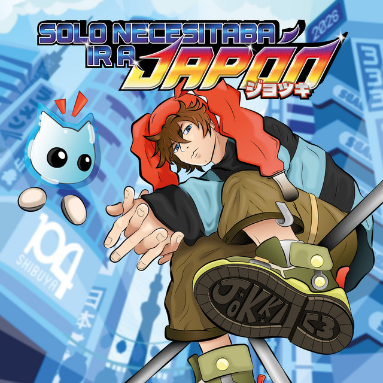
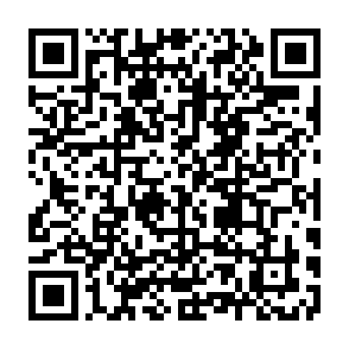

# Solo Necesitaba ir a Japón

Mini-historia para **Nintendo 3DS / 2DS** que presenta el álbum de **Todo Me Molesta**.

## Instalar con FBI (escaneando el QR)

1. En la consola (con CFW), abre **FBI** → **Remote Install** → **Scan QR Code**.
2. Escanea este código y confirma la instalación:

3. Al terminar, el juego aparece en el menú HOME.

> Si tenías una versión anterior instalada y el icono no cambia, bórrala en
> *Configuración de la consola → Gestión de datos* y vuelve a instalar.

## Descarga directa

[SoloNecesitabaIrAJapon.cia](https://github.com/dap0ry/solo-necesitaba-ir-a-japon/releases/latest/download/SoloNecesitabaIrAJapon.cia)
(~290 MB). Cópialo a la SD e instálalo con FBI.

El QR y el enlace apuntan siempre a la última versión publicada.
